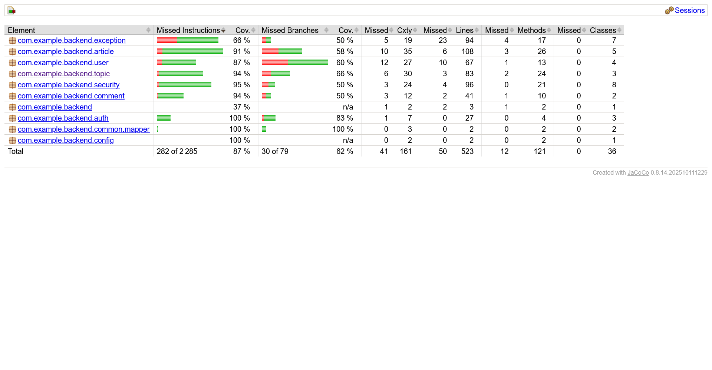
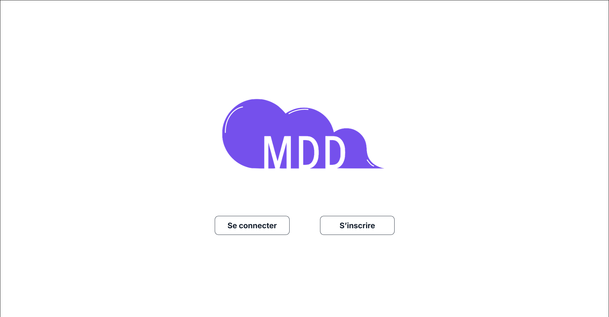
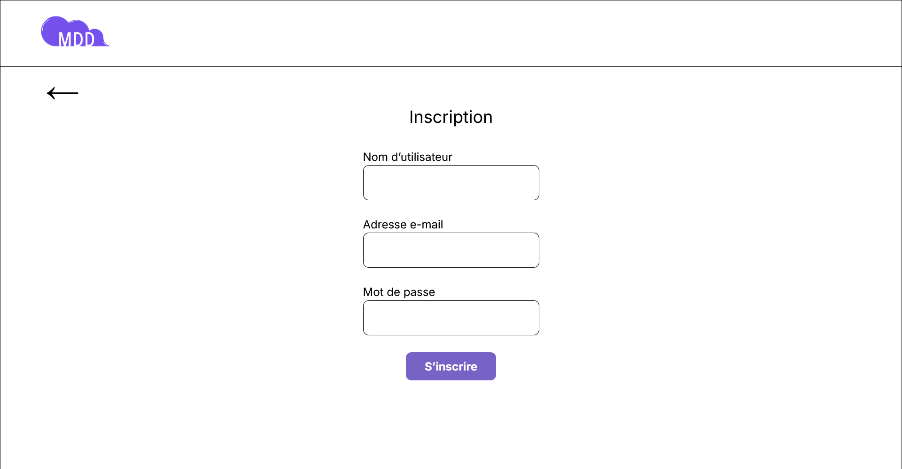
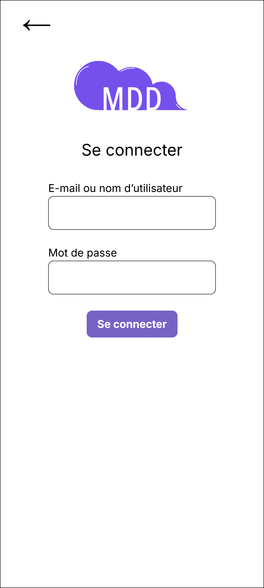
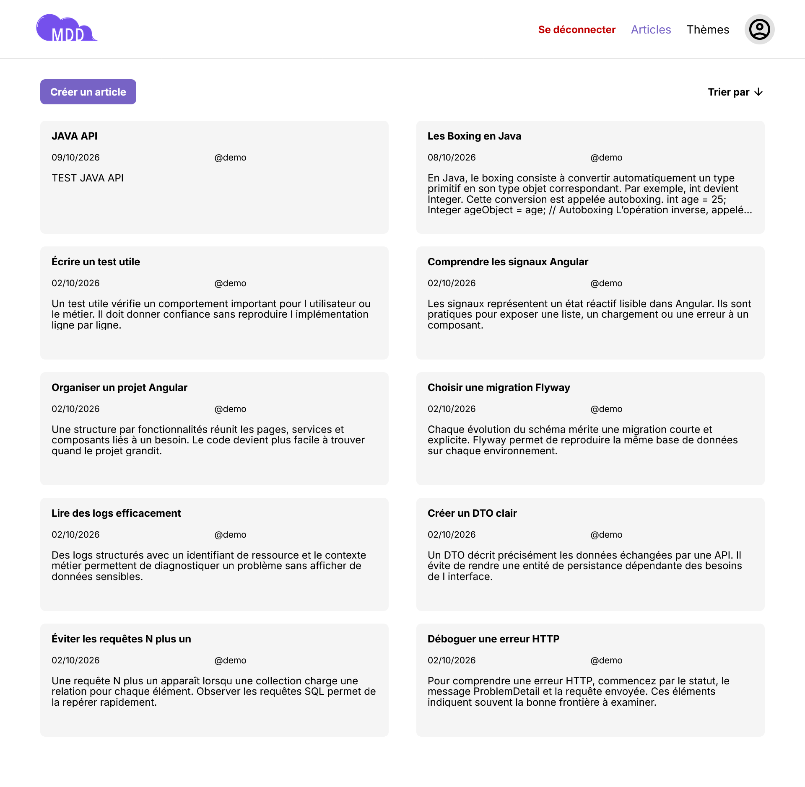
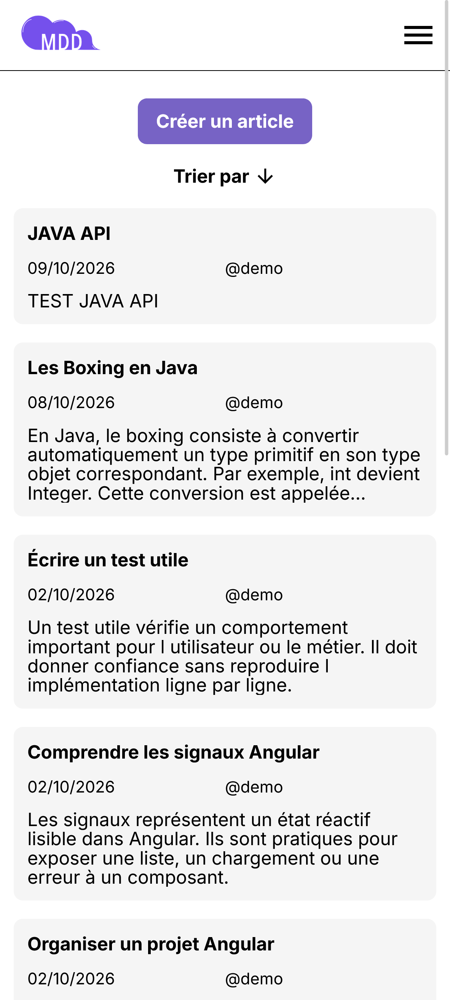
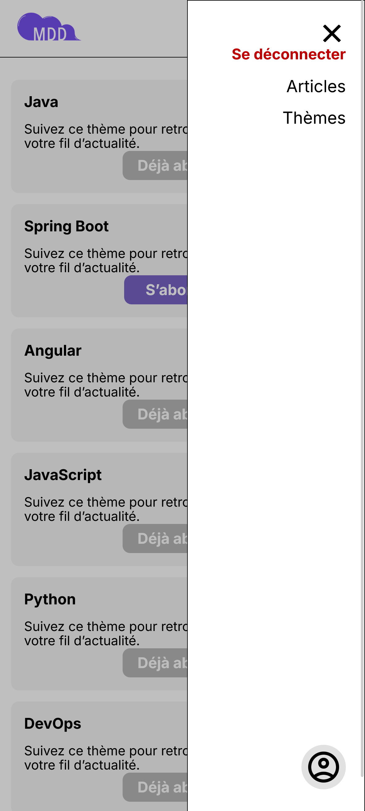
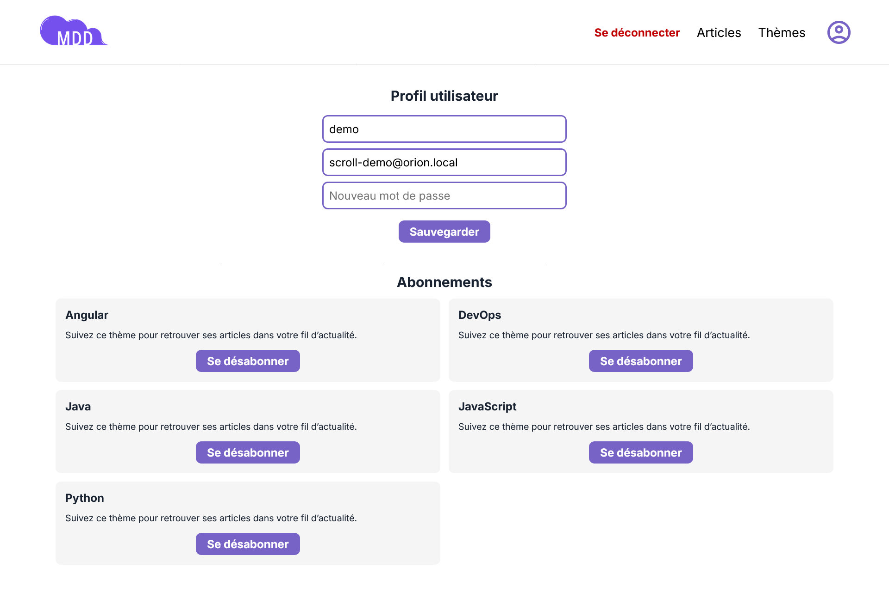
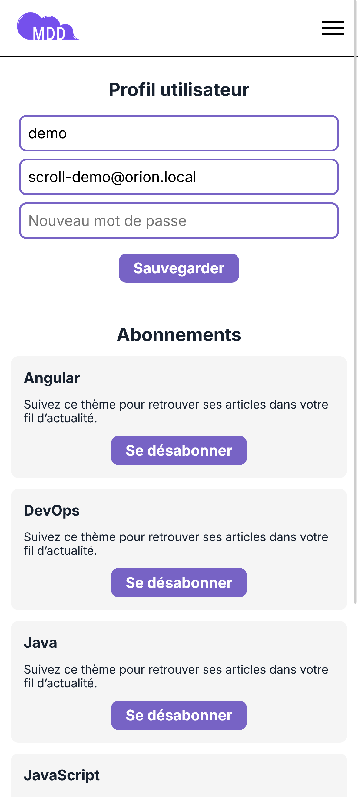

# Orion — documentation technique

## Sommaire

1. [Choix de conception](#1-choix-de-conception)
2. [Architecture et organisation](#2-architecture-et-organisation)
3. [Prérequis et installation](#3-prérequis-et-installation)
4. [Configuration d’environnement](#4-configuration-denvironnement)
5. [Données et persistance](#5-données-et-persistance)
6. [Contrat API et endpoints](#6-contrat-api-et-endpoints)
7. [Sécurité et gestion des erreurs](#7-sécurité-et-gestion-des-erreurs)
8. [Qualité et tests](#8-qualité-et-tests)
9. [FAQ utilisateur](#9-faq-utilisateur)
10. [Axes d’amélioration](#10-axes-damélioration)
11. [Interfaces et responsive design](#11-interfaces-et-responsive-design)

---

## 1. Choix de conception

### API first

Le projet adopte une démarche **API first**. Le fichier [openapi/openapi.yaml](../openapi/openapi.yaml) constitue le contrat de référence : il décrit les ressources, les formats de requêtes et de réponses, les statuts HTTP, les validations et les erreurs.

Ce choix garantit une compréhension partagée entre les développements frontend et backend, la génération des interfaces et DTO Spring, la génération du client Angular et une documentation interactive maintenue dans Swagger UI. Les sources générées ne sont pas modifiées manuellement. Les règles métier restent dans les services, les contrôleurs et les mappers du projet.

### Séparation des responsabilités

L’architecture sépare explicitement l’interface Angular, l’API REST Spring Boot, la persistance PostgreSQL, le contrat OpenAPI et la configuration locale. Les entités JPA ne sont jamais exposées directement par l’API : les DTO représentent le contrat public et MapStruct réalise les conversions nécessaires. Cette séparation limite le couplage entre la base de données et les clients HTTP.

### Authentification stateless

L’API repose sur des jetons JWT Bearer. Le backend reste stateless : il vérifie la signature et les dates du jeton à chaque requête protégée, sans conserver de session serveur. Le frontend maintient la session locale et protège les routes privées par un guard Angular.

### Technologies retenues

#### Frontend

- Angular 22 et TypeScript 6 ;
- Angular Material et CDK ;
- RxJS, formulaires réactifs et signaux Angular ;
- `httpResource` pour le chargement réactif des thèmes ;
- OpenAPI Generator pour le client Angular ;
- Vitest pour les tests unitaires et Cypress pour les parcours end-to-end.

#### Backend

- Java 21 et Spring Boot 4.1 ;
- Spring Web MVC, Spring Data JPA et Jakarta Validation ;
- Spring Security et Resource Server OAuth2 pour la validation JWT ;
- PostgreSQL 17 et Flyway ;
- MapStruct 1.6 et Lombok ;
- Springdoc OpenAPI / Swagger UI ;
- H2 pour les tests isolés ;
- JaCoCo pour les rapports de couverture ;
- `springboot4-dotenv` pour la configuration locale non versionnée.

---

## 2. Architecture et organisation

L’application comporte trois modules principaux :

- `frontend/` : application Angular ;
- `backend/` : API REST Spring Boot ;
- `openapi/` : contrat partagé entre les deux applications.

PostgreSQL assure la persistance. Flyway applique les migrations versionnées. Le navigateur communique exclusivement avec l’API ; aucune connexion directe à la base de données n’est exposée.


### Frontend

```text
frontend/src/app/
├── core/        # Authentification, intercepteurs HTTP, shell et navigation
├── features/    # Fonctionnalités métier : auth, articles, feed, thèmes, profil…
├── shared/      # Composants et pages réutilisables
└── app.routes.ts
```

Les composants, services et modèles sont regroupés par fonctionnalité. Les routes sont chargées à la demande. Les services isolent les appels HTTP et les composants restent centrés sur l’affichage et les interactions utilisateur.

### Backend

```text
backend/src/main/java/com/example/backend/
├── auth/          # Inscription, connexion et émission du JWT
├── user/          # Profil et persistance des utilisateurs
├── topic/         # Thèmes et abonnements
├── article/       # Publication, fil et détail des articles
├── comment/       # Commentaires associés à un article
├── security/       # Configuration Spring Security et JWT
├── exception/      # Erreurs RFC 9457 ProblemDetail
├── config/         # Configuration applicative
└── common/         # Éléments techniques partagés
```

Les contrôleurs implémentent les interfaces générées depuis OpenAPI. Les services portent les règles métier. Les repositories JPA réalisent les opérations de persistance.

---

## 3. Prérequis et installation

### Prérequis

- Java 21 ;
- Maven 3.9 ou version supérieure ;
- Node.js et npm ;
- Docker Desktop, afin d’utiliser le conteneur PostgreSQL local.

### Démarrer la base de données

```powershell
cd backend
docker compose up -d
```

PostgreSQL est exposé sur le port `5433`. Ce choix évite un conflit avec une installation locale utilisant habituellement le port `5432`.

### Démarrer le backend

```powershell
cd backend
mvn spring-boot:run
```

L’API est disponible sur `http://localhost:8080/api/v1`.

### Démarrer le frontend

```powershell
cd frontend
npm install
npm start
```

L’application est disponible sur `http://localhost:4200`.

### Compte local de démonstration

Les migrations créent un compte destiné exclusivement aux démonstrations locales et au test du fil d’actualité :

- nom d’utilisateur : `demo` ;
- e-mail : `scroll-demo@orion.local` ;
- mot de passe : `Orion2026!`.

Ce compte ne doit pas être déployé dans un environnement exposé.

---

## 4. Configuration d’environnement

Le fichier `.env` du backend ne doit jamais être versionné. Il est créé localement depuis le modèle fourni :

```powershell
cd backend
Copy-Item .env.example .env
```

Les variables attendues sont :

- `DB_URL`, `DB_USERNAME`, `DB_PASSWORD` : connexion à PostgreSQL ;
- `CORS_ALLOWED_ORIGINS` : origine autorisée pour le frontend ;
- `JWT_ISSUER`, `JWT_ACCESS_TOKEN_TTL`, `JWT_KEY_ID` : paramètres du jeton ;
- `JWT_SECRET` : secret encodé en Base64 contenant au moins 32 octets.

La valeur fournie dans `.env.example` est limitée au développement local. Tout secret de préproduction ou de production doit être injecté par le système de déploiement, jamais copié dans le dépôt, une capture d’écran ou un ticket.

---

## 5. Données et persistance

Le modèle de données est composé des tables suivantes :

- `users` : identité, e-mail unique, hash du mot de passe et rôle ;
- `topics` : nom unique, description et version d’optimistic locking ;
- `subscriptions` : relation unique entre un utilisateur et un thème ;
- `articles` : titre, slug unique, contenu, auteur et thème ;
- `comments` : contenu, auteur et article associé.

Les règles d’intégrité principales sont les suivantes :

- un utilisateur ne peut s’abonner qu’une seule fois à un même thème ;
- un commentaire appartient à un seul article et n’est pas récursif ;
- la suppression d’un article entraîne celle de ses commentaires ;
- la suppression d’un utilisateur ou d’un thème entraîne celle de ses abonnements ;
- un utilisateur ayant publié un article ou un commentaire ne peut pas être supprimé sans traitement préalable ;
- un thème possédant des articles ne peut pas être supprimé.


Les migrations Flyway sont situées dans `backend/src/main/resources/db/migration`. Elles sont appliquées dans leur ordre de version. Hibernate valide ensuite la cohérence entre les entités et le schéma.

---

## 6. Contrat API et endpoints

Le contrat source est disponible dans [openapi/openapi.yaml](../openapi/openapi.yaml). Il est servi par l’API, puis consultable dans Swagger UI :

```text
http://localhost:8080/api/v1/swagger-ui/index.html
```

Après une modification du contrat, les sources doivent être régénérées avant de développer ou de tester :

```powershell
cd backend
mvn generate-sources

cd ../frontend
npm run api:generate
```

### Authentification

- `POST /auth/register` : créer un compte ;
- `POST /auth/login` : obtenir un access token à partir d’un username ou d’un e-mail.

### Utilisateur et abonnements

- `GET /users/me` : consulter le profil et les abonnements ;
- `PATCH /users/me` : modifier username, e-mail ou mot de passe ;
- `GET /topics` : lister les thèmes et l’état d’abonnement ;
- `PUT /topics/{topicId}/subscription` : s’abonner ;
- `DELETE /topics/{topicId}/subscription` : se désabonner.

### Articles et commentaires

- `GET /articles` : consulter le fil avec `sort`, `page` et `size` ;
- `POST /articles` : publier un article ;
- `GET /articles/{articleId}` : consulter le détail d’un article ;
- `GET /articles/{articleId}/comments` : consulter les commentaires ;
- `POST /articles/{articleId}/comments` : ajouter un commentaire.

Le contrat référence aussi des opérations d’administration des thèmes et de suppression. Elles sont hors périmètre du MVP public. Avant une livraison, le contrat et l’implémentation doivent rester strictement alignés : une opération doit être complètement livrée et testée, ou être retirée du contrat exposé.

---

## 7. Sécurité et gestion des erreurs

Les ressources protégées attendent l’en-tête suivant :

```http
Authorization: Bearer <access-token>
```

Le frontend conserve le jeton de session et :

- protège les routes privées au moyen d’un guard ;
- ajoute le jeton uniquement aux requêtes dirigées vers l’API Orion ;
- ne transmet pas ce jeton à une URL tierce ;
- supprime la session et redirige vers la connexion lorsqu’une réponse `401` est renvoyée par une ressource protégée.

Les mots de passe sont stockés sous forme de hash BCrypt. Ils ne sont jamais retournés dans une réponse HTTP ou écrits dans les logs.

Les erreurs sont exprimées au format RFC 9457 `application/problem+json`. Elles contiennent notamment `type`, `title`, `status`, `detail`, `instance` et `code`. Une erreur de validation peut contenir l’objet `errors`, dont chaque propriété correspond à un champ du formulaire.

Les messages utilisateur sont centralisés dans `backend/src/main/resources/messages.properties`. Ils peuvent donc être cohérents, traduits et modifiés sans dupliquer des chaînes dans les contrôleurs.

---

## 8. Qualité et tests

La stratégie de test est répartie selon la responsabilité de chaque élément :

- tests unitaires des services backend et frontend ;
- tests de repository sur H2 ;
- tests d’intégration Spring Boot pour les endpoints métier ;
- tests Cypress des parcours : inscription, connexion, déconnexion, fil, thèmes, profil, publication, détail, commentaire et navigation mobile.

```powershell
# Backend : tests et rapport JaCoCo
cd backend
mvn clean test

# Frontend : tests unitaires et parcours Cypress
cd frontend
npm test
npm run cypress:run
```

Le rapport JaCoCo est produit après les tests backend dans `backend/target/site/jacoco/index.html`.




La couverture ne remplace pas la qualité fonctionnelle. Les scénarios prioritaires à conserver dans la suite sont la persistance de session après rechargement, la connexion par e-mail et username, le changement de mot de passe, la pagination réelle du fil et les réponses de validation `ProblemDetail`.

---

## 9. FAQ utilisateur

### Comment créer un compte ?

Depuis l’accueil, l’action **S’inscrire** ouvre le formulaire. Le nom d’utilisateur, l’e-mail et un mot de passe sécurisé sont obligatoires. Le mot de passe doit contenir au moins huit caractères, une minuscule, une majuscule, un chiffre et un caractère spécial.

### Comment se connecter ?

L’action **Se connecter** accepte le nom d’utilisateur ou l’adresse e-mail, accompagnés du mot de passe. Une connexion réussie affiche le fil d’actualité et persiste entre les visites tant que le jeton reste valide.

### Comment publier un article ?

Depuis le fil, l’action **Créer un article** ouvre le formulaire. Le thème, le titre et le contenu sont renseignés par l’utilisateur. L’auteur et la date sont définis automatiquement par le backend.

### Comment gérer les abonnements ?

La page **Thèmes** permet de s’abonner. Une fois l’opération réalisée, le bouton devient inactif et affiche **Déjà abonné**. La page **Profil** liste les abonnements et permet de se désabonner.

### Comment modifier le profil ?

La page **Profil** permet de modifier le nom d’utilisateur, l’e-mail ou le mot de passe. Lors d’un changement de mot de passe, le mot de passe actuel est demandé.

### Comment commenter un article ?

Depuis la page de détail, saisir le commentaire puis utiliser l’icône d’envoi. L’auteur et la date sont définis automatiquement.

---

## 10. Axes d’amélioration

Les évolutions suivantes permettraient d’atteindre un niveau de qualité adapté à une application professionnelle :

- stabiliser l’exécution des tests backend après génération OpenAPI afin que les DTO générés soient systématiquement disponibles lors des tests ;
- mettre en place une intégration continue exécutant génération OpenAPI, compilation, tests, contrôle de formatage et publication des rapports de couverture ;
- aligner strictement le contrat OpenAPI et les endpoints réellement livrés, en particulier pour les opérations hors MVP ;
- introduire un refresh token sécurisé par cookie `HttpOnly` si une session plus longue est nécessaire ;
- centraliser les logs et la supervision, sans y inclure d’information sensible ;
- définir une stratégie de sauvegarde et de restauration PostgreSQL avant tout déploiement ;

---

## 11. Interfaces et responsive design

Les maquettes de référence sont disponibles dans [Figma](https://www.figma.com/proto/Rflr3TVBog35BNMnn0DF09/Maquettes-MDD--desktop-et-mobile-?node-id=6-47&t=dqGDwihvbvRXY820-1). L’interface est conçue pour préserver les fonctionnalités essentielles, quel que soit le format d’écran.

### Accueil, inscription et connexion








### Fil d’actualité et navigation







### Articles, thèmes et profil






Les formulaires adoptent une disposition verticale sur mobile. Les grilles d’articles, de thèmes et d’abonnements deviennent une seule colonne. Les libellés, messages de validation, contrastes et éléments de navigation restent accessibles au clavier et aux technologies d’assistance.

---

## Ressources complémentaires

- [README du projet](../README.md)
- [Contrat OpenAPI](../openapi/openapi.yaml)
- [Justification des choix techniques](Justification+des+choix+techniques.docx)
- [Maquettes Figma](https://www.figma.com/proto/Rflr3TVBog35BNMnn0DF09/Maquettes-MDD--desktop-et-mobile-?node-id=6-47&t=dqGDwihvbvRXY820-1)
